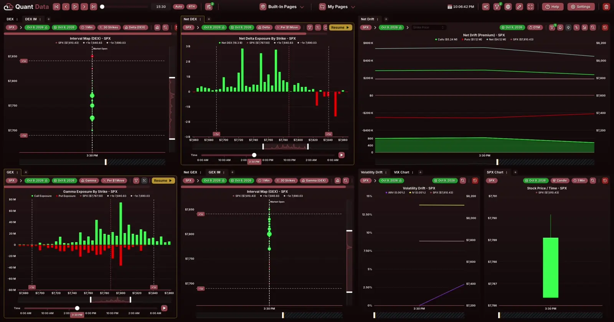
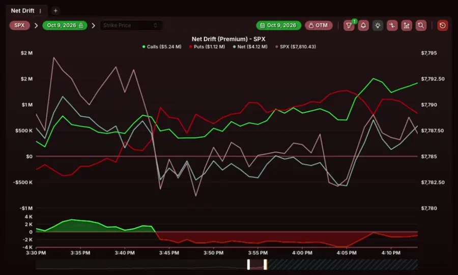
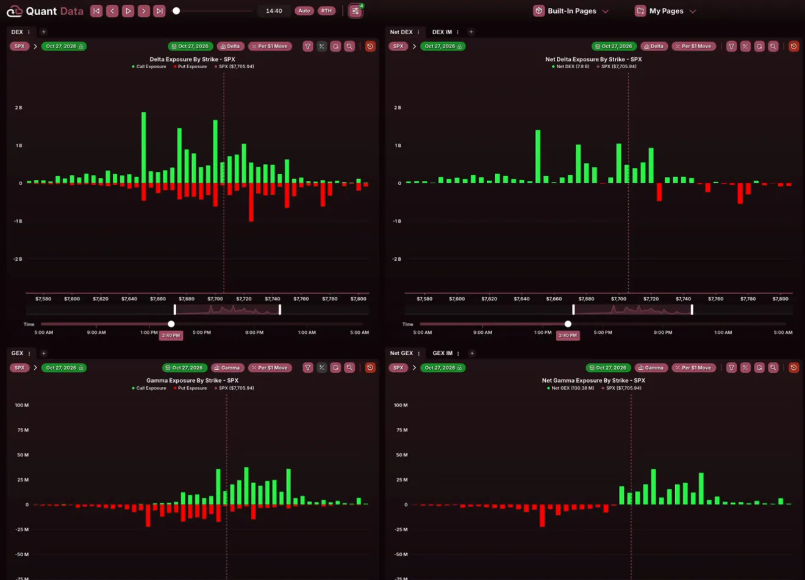
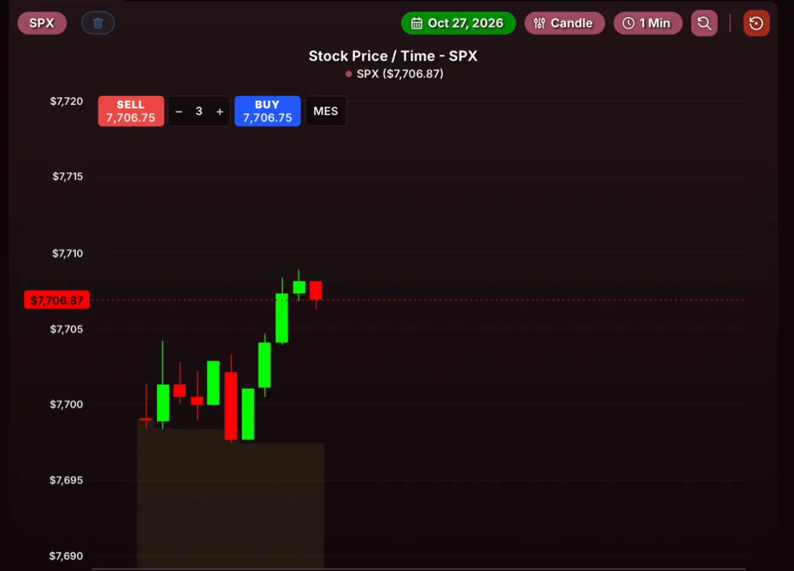
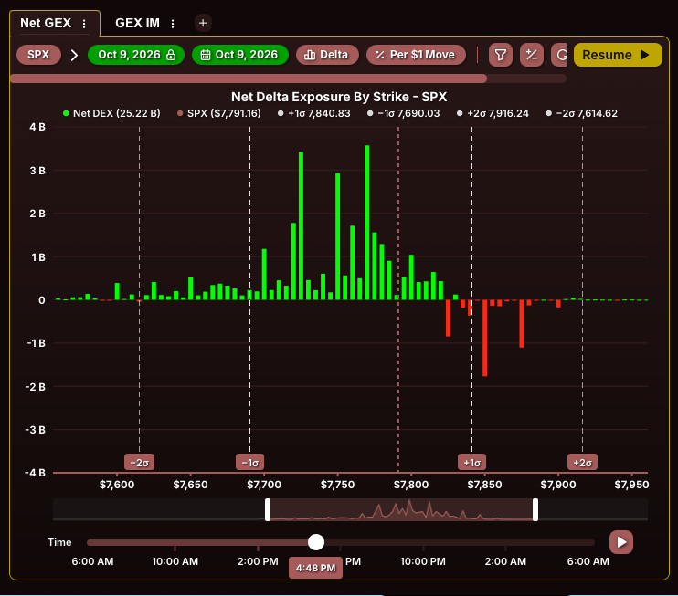
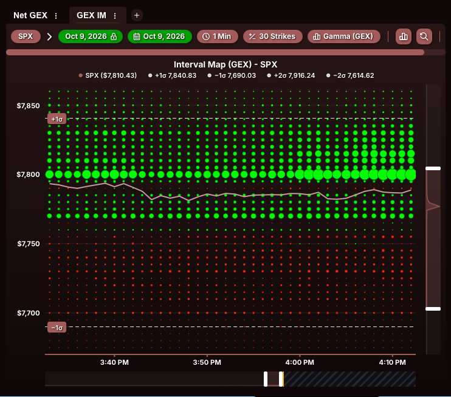
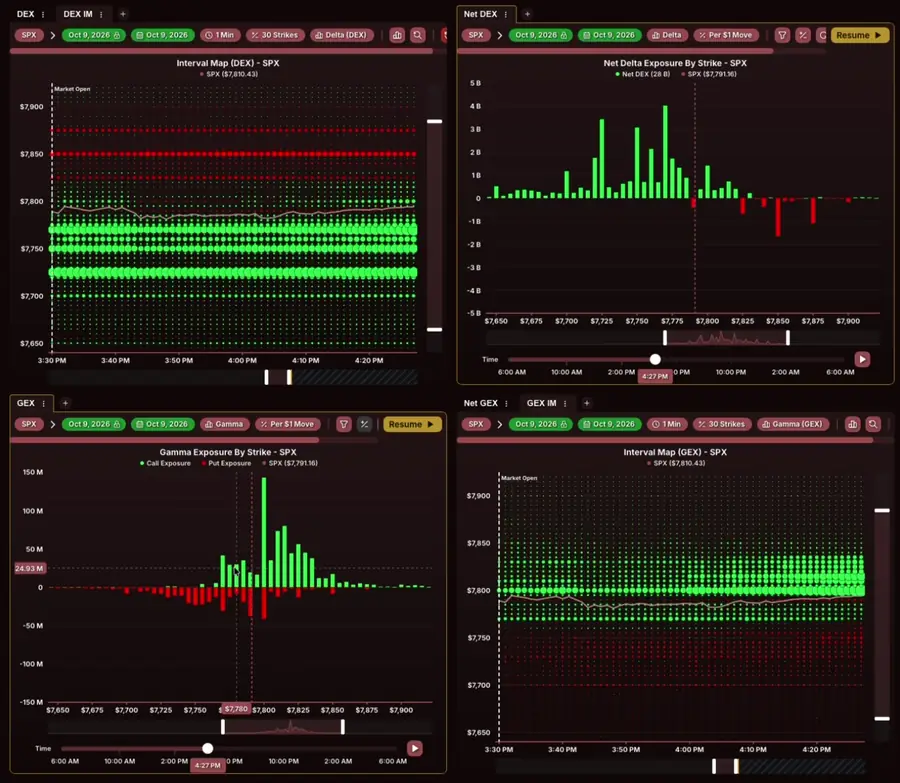
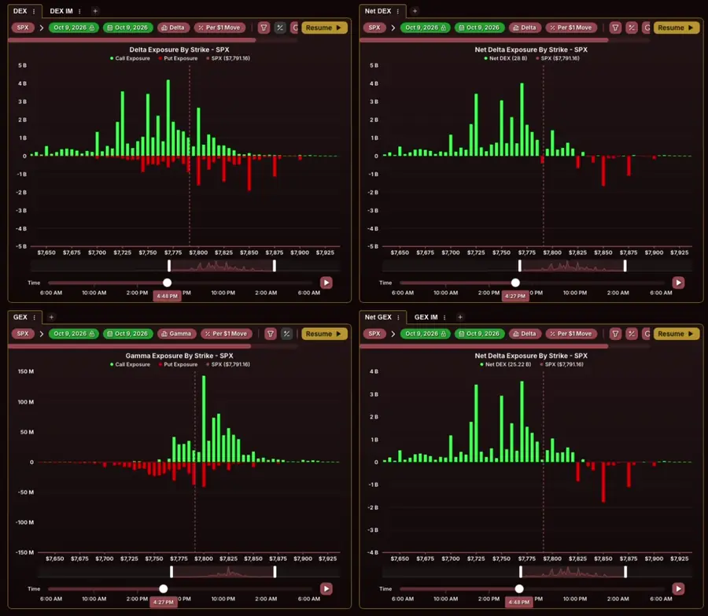
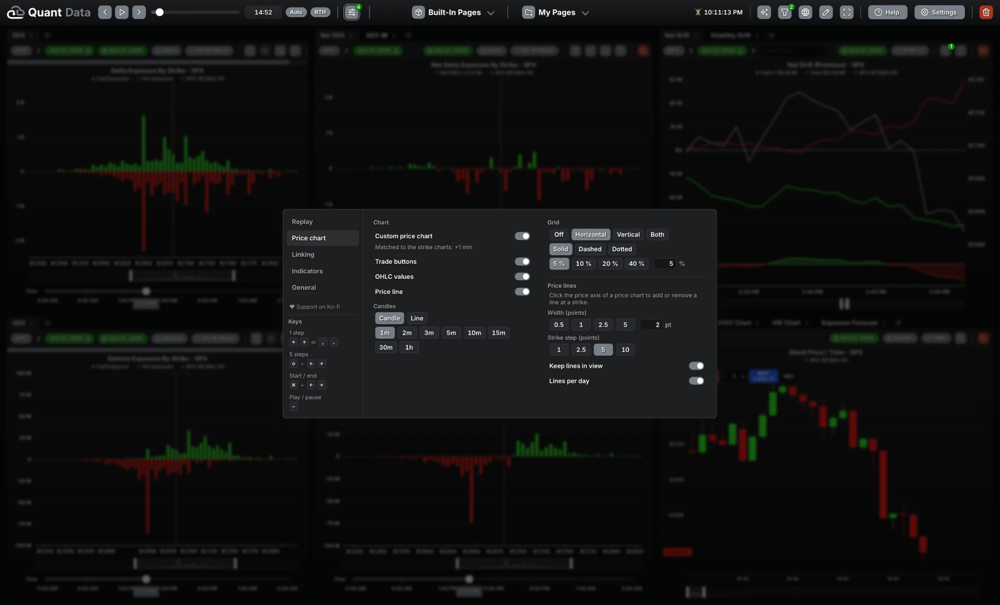

  

<h1 align="center">QD Toolkit</h1>

  <b>An all-round toolkit for <a href="https://quantdata.us">QuantData</a>.</b> 
  Replay a session on all your charts with one global time slider, as in a backtest. 
  See the expected move of the day with standard deviation lines. 
  And get many small changes that make QuantData easier to use.

  
  
  

  <a href="#install">Install</a> ·
  <a href="#features">Features</a> ·
  <a href="#use">Use</a> ·
  <a href="docs/GUIDE.md">User guide</a>

> [!IMPORTANT]
> QD Toolkit is an unofficial tool. It is not made by Quant Data LLC, and it is not affiliated with Quant Data LLC. It does not give financial advice.

## Features

### One global time slider: replay a session like a backtest

QuantData has a time slider in each chart. QD Toolkit adds one control panel to the QuantData header. The panel moves all time sliders on the page together, minute by minute. Thus you can replay a past session on all your charts at the same time.

- Step forward and back with the keys, or push Play. Play waits until QuantData has loaded the data.
- Type a time, or drag the master slider. All charts go to this time.
- The zoom bars of time charts (for example Net Drift) follow the time. The chart never shows the future: the panel covers the preview after the synced minute.
- While a chart loads, the panel shows the old chart with a small spinner, not an empty "Loading" box.
- Play counts the QuantData requests and stays below the rate limit.

### Cache: instant steps, fewer requests (Beta)

QD Toolkit keeps the minutes that you loaded before. A step back to such a minute shows at once and uses none of your request limit. Turn it on in the menu: Replay › Cache › Enable cache.

### A price chart for backtesting

The custom price chart replaces the Stock Price / Time chart. It shows the candles up to the replay minute only, with a fixed candle width and free pan and zoom. Candles of 1 minute to 1 hour, or a line. Add price lines at strikes with a click on the price axis.

- **Trade buttons:** buy and sell at the replay price for paper trading (ES / MES, NQ / MNQ, RTY / M2K). Drag a take profit and a stop loss out of the position line. The position closes when the replay reaches them.
- **Gap close:** a box and a label show the overnight gap and how much of it is filled.

### Standard deviation lines

The strike charts show the expected move of the session (the 15.87 rule): prior close ± 1σ, 2σ or 3σ, with 1σ = prior close × prior-close VIX ÷ 15.87 %. The panel reads the prior close and the VIX automatically. The lines can also show on the custom price chart.

<table>
  <tr>
    <td></td>
    <td></td>
  </tr>
</table>

### Many quality-of-life changes

- **Linked strike charts:** zoom one strike chart, and the other charts of the same ticker show the same strikes.
- **Crosshair line in all charts:** move the mouse on one chart, and the other charts show a line at the same strike or minute.
- **Draggable value scale:** the value axis of the strike charts stays fixed, so you can compare 2 minutes. Drag it to change the range.
- **Time in your time zone:** the panel can show all times in your local time.
- **All tabs together:** a step in one QuantData tab also moves the charts in your other QuantData tabs.
- **Clean settings:** one menu in the middle of the window, in 5 categories, in 3 sizes.
- **Setup guide:** at the first start, a short guide shows the features and their switches.

<table>
  <tr>
    <td width="50%"> Linked strike charts</td>
    <td width="50%"> Crosshair line in all charts</td>
  </tr>
</table>

## Install

QD Toolkit is a userscript. A userscript app or extension runs it on the QuantData page. Use one of these ways.

### Safari on the Mac (Userscripts app)

1. Install the free app "Userscripts" from the Mac App Store.
2. Open the Userscripts app. Select a folder for your scripts.
3. Download [`qd-toolkit.user.js`](https://github.com/julianhtg/qd-toolkit/releases/latest/download/qd-toolkit.user.js) from the latest release.
4. Copy the file into your Userscripts folder.
5. In Safari, open Settings > Extensions.
6. Enable "Userscripts".
7. Open QuantData.
8. Click the Userscripts icon in the Safari toolbar.
9. Select "Always Allow on This Website".
10. Reload the page.

The panel shows in the QuantData header, after the QuantData logo.

### Chrome, Edge, Brave or Firefox (Tampermonkey or Violentmonkey)

1. Install the extension "Tampermonkey" or "Violentmonkey" from the extension store of your browser.
2. Chrome, Edge and Brave only: open the details of the extension (Manage extensions) and turn on "Allow User Scripts".
3. Open the install link: [`qd-toolkit.user.js`](https://github.com/julianhtg/qd-toolkit/releases/latest/download/qd-toolkit.user.js).
4. Click "Install" on the page of the extension.
5. Reload QuantData.

### Optional: the prior-close VIX ("QD Toolkit Data")

The standard deviation lines need the VIX close of the day before. This value is not on the QuantData page. The optional second script "QD Toolkit Data" loads it from the free daily VIX history of Cboe. Without it, type the VIX value by hand.

Install [`qd-toolkit-data.user.js`](https://github.com/julianhtg/qd-toolkit/releases/latest/download/qd-toolkit-data.user.js) in the same way as the main script.

### Update

- Tampermonkey and Violentmonkey find new versions automatically.
- Userscripts app: download the new file and replace the old file in your folder.
- After an update, reload all QuantData tabs. A tab with the old version can move the sliders two times.

Use only one copy of QD Toolkit. If two copies run (for example in two userscript apps), each step moves the sliders two times.

## Use

| Control | Result |
| --- | --- |
| `→` or `.` | All sliders go 1 step forward. |
| `←` or `,` | All sliders go 1 step back. |
| `Shift` + `→` / `←` | All sliders go 5 steps. |
| `Cmd` + `→` / `←` (Windows: `Ctrl`) | All sliders go to the end or to the start. |
| `-` | Play or pause. |
| Master slider | Drag it and release it. All sliders go to this time. |
| Time field | Shows the time in ET, or in your time zone (see [Time](docs/GUIDE.md#time)). Click it, type a time (for example `10:45`, `1045` or `1:45 pm`), then push `Enter`. All sliders go to this time. `Esc` cancels. |
| Start / end buttons | All sliders go to the start or to the end. With "RTH" on, the start is 09:30 ET and the end is 16:00 ET. |
| "RTH" | Turns the RTH range on or off. With "RTH" on, the start and end buttons, the master slider and play use 09:30–16:00 ET only. When "RTH" is on, the button is filled with color. When it is off, the button has only an outline. |
| Speed menu | Sets the time between two steps during play. "Auto" waits until QuantData has loaded the data for the step. Play can wait longer because of the request budget (see [Rate limit](docs/GUIDE.md#rate-limit)). |
| "≠ Align" | Shows when the sliders have different times. Click it to move all sliders to the time of slider 1. |
| Menu button (slider icon with number) | Shows the number of active sliders. Click it to open the menu with all settings. The menu opens in the middle of the window, and the page behind it gets darker. To close the menu, click the button again, click outside the menu, or push `Esc`. |
| `–` button | Makes the panel small. Click the small panel to open it again. Only the panel at the bottom of the page has this button. |

For all details (setup, cache, price chart, trade buttons, zoom bars, linked charts, standard deviation lines, rate limit, limits and privacy), see the **[user guide](docs/GUIDE.md)**.

If something does not work, send a message on Discord (`bsjuli`) or open an [issue](https://github.com/julianhtg/qd-toolkit/issues). The panel can copy a report for it: open the menu, click "General", then "Copy report…".

QD Toolkit runs only in your browser. It sends no data to other servers and does not call the QuantData API.

## License

MIT. See [LICENSE](LICENSE). QuantData and its data belong to Quant Data LLC.
